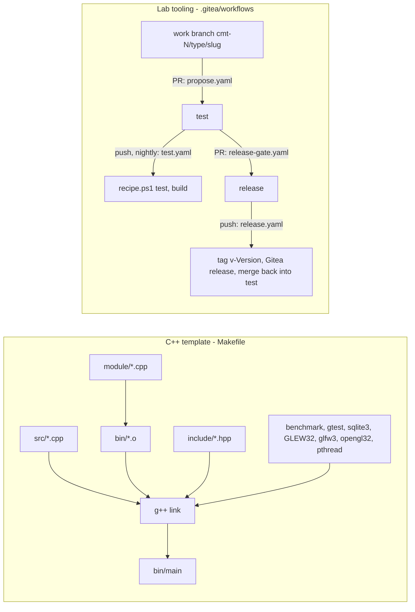

# cpp-modern-template: documentation hub

`cpp-modern-template` is a C++20 project skeleton from August and September 2023:
a `Makefile` for g++ under MSYS2 MinGW, the Visual Studio Code settings written
by the Easy C++ Projects extension, and one example program that draws a red
triangle in a GLFW/OpenGL window (`README.md:3-5`, `src/main.cpp`). The project
README calls it "a template to copy from, not a program" (`README.md:5`). Since
November 2026 the repository also carries the owner's lab tooling: `recipe.ps1`,
Git hooks, Claude Code hooks and five Gitea Actions workflows. Who copies the
template, besides the owner, is not stated anywhere (see SPEC.md, Open questions).

The requirements reverse-engineered from the code are in [SPEC.md](../SPEC.md).

## Status

- Last commit: `44d63d7`, 2026-11-08 00:40:55 +0200, "Merge pull request 'chore(core): bring
  cpp-modern-template to revision 4.0.0' (#18) from test into release" (`git log -1`).
  The tag `v1.0.0` points at the same commit (`git tag -l`, `git rev-parse v1.0.0^{}`).
- History: 19 commits. The C++ files date from 2023-08-28 to 2023-09-14; the
  licence commit is from 2026-08-05; everything else is from 2026-11-08 (`git log`).
- Tests: none. `python -m pytest --collect-only -q -p no:cacheprovider .claude`
  prints "no tests collected" (exit 5), and `recipe.ps1` accepts exit 5
  (`recipe.ps1:47-48`). There are no tests for the C++ code.
- CI: five Gitea Actions workflows in `.gitea/workflows/` (`propose`, `test`,
  `release-gate`, `release`, `sweep`). There is no `.github/` directory, so
  GitHub runs nothing. No workflow compiles the C++ code: `recipe.ps1 build`
  prints `nothing to build` (`recipe.ps1:69-73`), and the README says the runner
  has neither the libraries nor a display (`README.md:28-29`).
- TODO/FIXME markers: 0 (`git grep -iE '\bTODO\b|\bFIXME\b'`).
- Unfinished, as the repository itself states: five exceptions to the lab
  requirements, R-02 (#7), R-09 (#8), R-37 (#9), R-41 (#10), R-42 (#11)
  (`README.md`, section "Lab requirements"). The folders `include/`, `lib/`,
  `module/` and `bin/` that the `Makefile` uses are not in the repository
  (`README.md:20-21`).

## Layout

| Path | What it is |
|---|---|
| `src/main.cpp` | The example program: GLFW window, GLEW, one VBO, two shaders, render loop. |
| `Makefile` | g++ build of `src/*.cpp` and `module/*.cpp` into `bin/main`; targets `all`, `run`. |
| `.vscode/tasks.json` | Build task (`make`) and build-and-run task (`make run`). |
| `.vscode/launch.json` | gdb debug configuration for `bin/main`. |
| `.vscode/c_cpp_properties.json` | IntelliSense: MSYS2 MinGW g++ path and include path. |
| `.vscode/settings.json` | File associations; C/C++ error squiggles disabled. |
| `.vscode/.easycpp` | Marker file of the Easy C++ Projects extension. |
| `recipe.ps1` | The repository's command interface (verbs `test`, `info`, `clean`, ...) and its metadata. |
| `CLAUDE.md` | The repository's working rules (branches, commits, gates, keys). |
| `.claude/settings.json` | Claude Code environment variables and hook registrations. |
| `.claude/hooks/gate.ps1` | PreToolUse hook that denies recursive deletes, force-pushes, history rewrites. |
| `.claude/hooks/log.ps1`, `session-start-stop.ps1` | Hooks that append events to `.claude/logs/ai.jsonl`. |
| `.claude/hooks/git/` | Git hooks `commit-msg` and `pre-push` (sh wrappers plus PowerShell). |
| `.claude/pytest.ini`, `.claude/ruff.toml` | pytest config (empty) and the ruff version pin. |
| `.claude/skills/lab-ai-env/SKILL.md` | Claude Code skill that reports on the hooks' log. |
| `.gitea/workflows/*.yaml` | CI: `propose`, `test`, `release-gate`, `release`, `sweep`. |
| `.gitea/issue_template.md`, `pull_request_template.md` | Issue and PR templates. |
| `.gitattributes`, `.gitignore` | Line endings, LFS patterns, ignored paths. |
| `LICENSE` | MIT licence, 2023. |

## Architecture

The repository holds two independent parts.

1. The C++ template. The `Makefile` compiles each `module/*.cpp` to `bin/<name>.o`
   (`Makefile:10-11,25-26`) and links all `src/*.cpp`, those objects and any
   `include/*.hpp` into `bin/main` with nine fixed libraries (`Makefile:17,31-32`).
   The only source file, `src/main.cpp`, talks to the GPU through GLFW, GLEW and
   OpenGL; it reads no files, no network and no arguments. The other linked
   libraries (Google Benchmark, Google Test, SQLite) are not used by any source.
2. The lab tooling. `recipe.ps1` is the interface the hooks and the workflows
   call; they also read its metadata lines as text (for example `$Code`,
   `$CommitTypes`, `$BranchTypes`, `$Version`). The workflows run on a Gitea
   server with Windows runners and call the Gitea REST API with the secret
   `LAB_BOT_TOKEN`.



## Build and run

Prerequisites, as far as the files name them (no versions are pinned anywhere,
and there is no lock file):

- g++ with C++20 and `-fmodules-ts`, and GNU make (`Makefile:1-2`). The VS Code
  configuration points at `C:/msys64/mingw64/bin/g++.exe` (`.vscode/c_cpp_properties.json:15`).
- The libraries in `Makefile:17`: Google Benchmark, Google Test, SQLite 3, GLEW,
  GLFW 3, OpenGL, pthread. The 2023 README (in history, `git show 7bd1988:README.md`,
  lines 19-27) installed them under MSYS2 with, among others:
  `pacman -S mingw-w64-x86_64-gtest`, `pacman -S mingw-w64-x86_64-sqlite3`,
  `pacman -S mingw-w64-x86_64-benchmark`, `pacman -S mingw-w64-x86_64-glew`,
  `pacman -S mingw-w64-x86_64-glfw`. These lines were not run for this document.
- gdb on `PATH` for debugging (`.vscode/launch.json:15-16`).
- For the lab tooling: Windows PowerShell, Python 3 with pytest and ruff
  `==0.16.1` (`recipe.ps1:46-52`, `.claude/ruff.toml:2`).

Build and run the example (Windows, MSYS2 MinGW shell). Create the `bin/`
folder first: the `Makefile` writes `bin/main` but does not create the folder
(`Makefile:31-32`, `README.md:20-21`).

| Command | What it does | Source |
|---|---|---|
| `make` | Builds `bin/main` (target `all`). | `Makefile:20`, `.vscode/tasks.json:11` |
| `make run` | Builds, then runs `./bin/main`. | `Makefile:22-23`, `.vscode/tasks.json:20-23` |
| VS Code "C++ Debug (gdb)" | Runs the task "Build C++ project", then starts `bin/main` under gdb in an external console. | `.vscode/launch.json:5-17` |
| `.\recipe.ps1 test` | Sets `core.hooksPath`, runs pytest, `ruff check` and `ruff format` over `.claude`. | `recipe.ps1:41-55`, `README.md:41` |
| `& (Join-Path (git rev-parse --show-toplevel) recipe.ps1) test` | The same, from any folder of the repository. | `CLAUDE.md:15` |
| `.\recipe.ps1 info` | Prints name, code, version, summary. | `recipe.ps1:56-62` |
| `.\recipe.ps1 clean` | Deletes `__pycache__`, `.pytest_cache`, `.ruff_cache` folders. | `recipe.ps1:63-68` |

There is no install step: `recipe.ps1` has no `$App` and `$Provides = @()`
(`recipe.ps1:16-17`), and `install`, `uninstall`, `publish`, `build`, `run`
print `nothing to <verb>` (`recipe.ps1:69-73`).

## Configuration

| Name | Where | Meaning | Default |
|---|---|---|---|
| `CXX`, `CXX_FLAGS` | `Makefile:1-2` | Compiler and flags. | `g++`; `-Wall -Wextra -std=c++20 -ggdb -fmodules-ts` |
| `BIN`, `SRC`, `INCLUDE`, `LIB`, `MODULE` | `Makefile:4-8` | Folder names. | `bin`, `src`, `include`, `lib`, `module` |
| `LIBRARIES` | `Makefile:17` | Libraries linked into every build. | the nine `-l` flags listed there |
| `EXECUTABLE` | `Makefile:18` | Output name in `bin/`. | `main` |
| Qt 5 libraries | `Makefile:15-16` | A comment with `pacman -S mingw-w64-x86_64-qt5` and the `-lQt5...` flags to add by hand. | not linked |
| `includePath`, `compilerPath`, `cppStandard`, `defines` | `.vscode/c_cpp_properties.json:5-17` | IntelliSense settings. | workspace and `C:\msys64\mingw64\include`; MSYS2 g++; `c++23`; `_DEBUG`, `UNICODE`, `_UNICODE` |
| `.claude/.env` | `recipe.ps1:28-38`, `.gitignore:24` | `NAME=value` lines loaded into the environment by every `recipe.ps1` verb; a variable already set wins. Gitignored; absent in a fresh clone. No code in this repository reads a particular variable from it. | absent |
| `PYTHONIOENCODING`, `PYTHONUTF8`, `MSYS_NO_PATHCONV` | `.claude/settings.json:2-6` | Environment for Claude Code sessions. | `utf-8`, `1`, `1` |
| `core.hooksPath` | `recipe.ps1:42`, `.claude/hooks/session-start-stop.ps1:34` | Set to `.claude/hooks/git` by `recipe.ps1 test` and by the SessionStart hook. | Git default until one of them runs |
| `$Name`, `$Code`, `$Version`, `$Summary` | `recipe.ps1:9-12` | Metadata; `$Version` becomes the release tag `v<version>` (`release.yaml:45-60`). | `cpp-modern-template`, `cmt`, `1.0.0` |
| `$CommitTypes`, `$CommitScopes`, `$BranchTypes` | `recipe.ps1:19-21` | Vocabulary the hooks and `propose.yaml` check. | see the file |
| `$Reviewers`, `$OverridePhrase` | `recipe.ps1:22-23` | Who may change `release`; the phrase that marks an owner's override. The value is not repeated here. | one login |
| `LAB_BOT_TOKEN` | all workflows, e.g. `propose.yaml:24-25` | Gitea secret used as `TOKEN` / `GITEA_TOKEN` for API calls. | must be set on the server |
| `WAIT_MINUTES` | `release-gate.yaml:101` | How long `manual-gate` waits for manual results. | `150` |

The example program takes no arguments, environment variables or files.

## Usage

1. Start a C++ project from the template: copy the repository, put sources in
   `src/`, optional headers in `include/`, optional C++20 module sources in
   `module/`, libraries in `lib/`; create `bin/`; run `make run`. Remove the
   libraries you do not need from `LIBRARIES` (`Makefile:17`), since all of
   them are linked into every build.
2. Debug in VS Code: open the folder and start "C++ Debug (gdb)"; the
   pre-launch task builds with `make` (`.vscode/launch.json:9`, `.vscode/tasks.json:5-11`).
3. Check the example: `make run` should open a 640 x 480 window titled
   "Привет, OpenGL" ("Hello, OpenGL") with a red triangle; closing the window
   ends the program with exit code 0 (`src/main.cpp:13,30-34,55,96-115`).
   Error messages go to stderr in Russian. Not run for this document.
4. Work on the repository itself (`CLAUDE.md:8-19`): open an issue, branch
   `cmt-<issue>/<type>/<slug>`, commit `<type>(<scope>): <what changed>` with
   `git commit -s`, run `.\recipe.ps1 test`, open a pull request into `test`.
5. Read the metadata. Output of `.\recipe.ps1 info` at `44d63d7`:

   ```text
   Name    : cpp-modern-template
   Code    : cmt
   Version : 1.0.0
   Summary : A C++20 Makefile template for MinGW with an OpenGL example program, 2023.
   ```

## Testing

- `.\recipe.ps1 test` (`recipe.ps1:41-55`) runs `python -m pytest .claude`
  (exit 5, "no tests collected", is accepted), `python -m ruff check .claude`
  and `python -m ruff format .claude`. The repository has no Python files, so
  today the verb checks nothing beyond the tools starting. The workflows run it
  and then `git diff --exit-code`, so unformatted files fail CI
  (`propose.yaml:144-152`, `test.yaml:54-58`, `release-gate.yaml:49-53`).
- The C++ code has no tests and is not compiled in CI. Google Test and Google
  Benchmark are linked (`Makefile:17`) but no test or benchmark source exists.
- `release-gate.yaml` has a manual test round driven by `tests/manual/tests.json`
  (`release-gate.yaml:107-150`). That file does not exist here, so the round
  records `manual/verdict` as success with "no manual tests defined".

## Known limitations and problems

1. The example is not built or run anywhere in this repository's automation
   (`recipe.ps1:69-73`, `README.md:28-29`). Whether it still builds with
   current MSYS2 packages is unknown.
2. Every build links Benchmark, Test, SQLite, GLEW, GLFW and OpenGL, and uses
   the Windows names `-lGLEW32` and `-lopengl32` (`Makefile:17`), so it does not
   link on Linux as written (`README.md:12-13`).
3. `bin/` is not created by the `Makefile` and is gitignored (`.gitignore:28`);
   the link step needs it to exist.
4. The link rule passes `$^`, which includes `include/*.hpp`, to g++
   (`Makefile:31-32`). What g++ does with header files on a link command line
   was not tested here. The rule `$(BIN)/%.o: $(INCLUDE)/%.hpp` (`Makefile:28-29`)
   is never used: the only `bin/*.o` any target asks for are the module objects,
   and for those the earlier rule from `module/%.cpp` (`Makefile:25-26`) applies.
5. Both `-lgtest_main` and `-lbenchmark_main` are linked next to a program that
   defines its own `main()` (`Makefile:17`, `src/main.cpp:5`). The effect on the
   link was not checked.
6. IntelliSense uses `c++23` (`.vscode/c_cpp_properties.json:17`); the compiler
   uses `-std=c++20` (`Makefile:2`).
7. `src/main.cpp` returns after a failed `glewInit()` without `glfwTerminate()`
   (`src/main.cpp:24-27`); shader compile and link errors are printed but the
   program keeps running (`src/main.cpp:66-91`); the VBO and the shader program
   are never deleted.
8. `README.md:42` says the verbs other than `test` and `info` print
   `nothing to <verb>`; `clean` deletes cache folders instead (`recipe.ps1:63-68`).
9. The lab requirements link in `README.md` points at `127.0.0.1:3000`, a
   loopback address, so it opens only on a machine that runs that server.
10. `test.yaml` requires `mypy` to answer on the runner (`test.yaml:38`),
    though nothing in the repository runs mypy.

## Related documents

- [README.md](../README.md) - project README.
- [SPEC.md](../SPEC.md) - requirements specification.
- [CLAUDE.md](../CLAUDE.md) - working rules.
- [LICENSE](../LICENSE) - MIT licence.
- [.claude/skills/lab-ai-env/SKILL.md](../.claude/skills/lab-ai-env/SKILL.md) - the hooks' log and the report skill.
- [.gitea/pull_request_template.md](../.gitea/pull_request_template.md), [.gitea/issue_template.md](../.gitea/issue_template.md) - templates.

## About this document

Written on 2026-11-18 from commit `44d63d7` (branch `release`).

Commands run to check it: `git status`, `git log`, `git ls-files`, `git tag -l`,
`git branch -a`, `git remote -v`, `git merge-base origin/master origin/main`
(exit 1, no common ancestor, as `README.md:33-34` says),
`git diff --stat 2b865cb import/master` (only `.gitignore` differs),
`git show 7bd1988:README.md`, `git grep` for TODO/FIXME,
`.\recipe.ps1 info`, `.\recipe.ps1 build`, `.\recipe.ps1 run` (both print
`nothing to <verb>`), `python -m pytest --collect-only -q -p no:cacheprovider .claude`
(exit 5), and tool lookups (Python 3.13.3 and pytest 9.1.1 present; ruff, make
and g++ not installed on the machine that wrote this).

Not run: `make`, `make run` (no compiler or libraries on that machine, and the
build writes `bin/`), `.\recipe.ps1 test` (it writes `core.hooksPath` into
`.git/config` and formats in place; ruff is not installed), `.\recipe.ps1 clean`,
the Git and Claude Code hooks, and the workflows.
